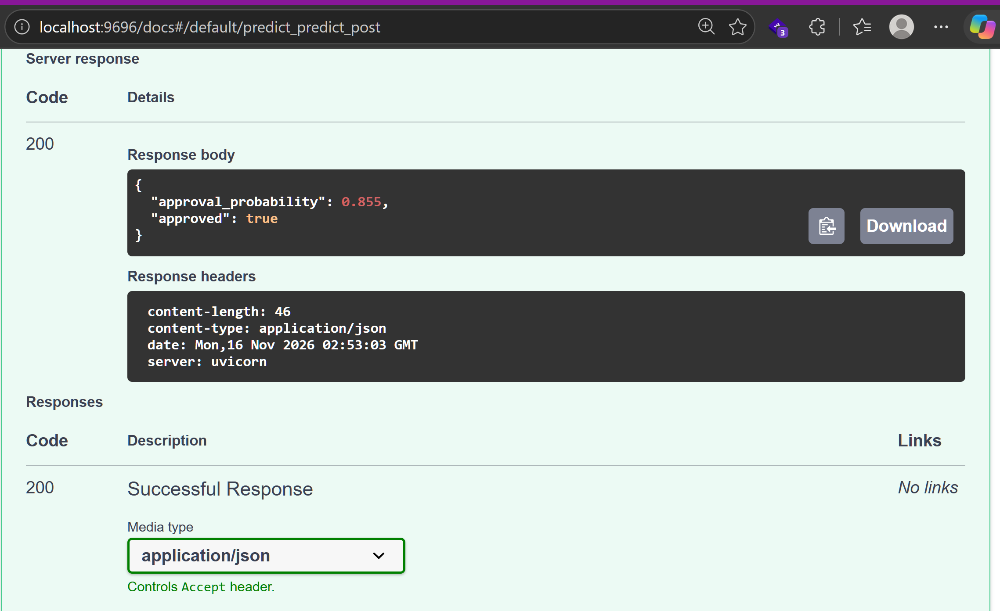

# San Diego Mortgage Approval Predictor

Will a San Diego mortgage application be approved or denied? This project trains a model on every 2025 mortgage application filed in San Diego County and serves it as a web service you can run on your own machine or in Docker.



## The problem

Buying a house (or any real estate) can be a very overwhelming experience, and getting a loan is probably the scariest and more complex part of it.
Can a buyer even get approved for a loan? How much and at what rate?
This tool is meant to measure a user's chance of loan approval.

## The data

Source: the 2025 HMDA (Home Mortgage Disclosure Act) public loan level data, published by the CFPB and FFIEC on March 31, 2026. Every US lender reports each mortgage application it receives.

I downloaded the California file from the [HMDA Data Browser](https://ffiec.cfpb.gov/data-browser/) and kept:

* applications in San Diego County (county code 06073)
* applications that were either funded (`action_taken` = 1) or denied (`action_taken` = 3)

That leaves **68,442 applications: 76.7% approved and 23.3% denied.** The filtered file is committed as `hmda_2025_san_diego.csv` (26 MB). The full California file is too large for GitHub, but a cell near the top of `notebook.ipynb` shows how the San Diego file was made from it.

Target: `approved` (1 = funded, 0 = denied).

Field definitions: [HMDA public data fields](https://ffiec.cfpb.gov/documentation/publications/loan-level-datasets/lar-data-fields/).

## What I removed, and why

| Group | Columns | Why |
|---|---|---|
| Leaks | denial reasons, interest rate, rate spread, HOEPA status, loan costs, points, lender credits, purchaser type | Only known after the decision |
| Hidden leaks | `preapproval`, `initially_payable_to_institution` | Found by checking approval rates per value (see below) |
| Constants and IDs | year, state, county, metro area, census tract, metro median income | Same for every row, or an ID |
| Mostly empty | `aus-2` to `aus-5`, multifamily units, prepayment penalty | Over 90% blank |
| Protected attributes | race, ethnicity, sex and age of applicant and co-applicant, tract minority % | Using them to predict lending decisions would be discriminatory. Kept aside for a future fairness check |

**Two hidden leaks.** For every category I checked the approval rate per value and flagged values with 0% or 100% approval and at least 500 rows:

* `preapproval` = 1 (requested) was approved 100% of the time. Denied preapproval requests are recorded as `action_taken` 7, which my own filter removed. So this column only looked predictive because of the filter.
* `initially_payable_to_institution` = 3 (not applicable) was denied 100% of the time (2,772 rows). Some lenders only use that code when no loan was made, so it is filled in after the decision.

Other cleaning: 73 negative incomes set to 0, 20 impossible loan to value ratios (up to 49,000,000%) set to blank, number codes converted to categories, and an `is_adjustable` flag created from `intro_rate_period`. Blank numbers are filled with medians from the training set only.

## What the data says

* **Debt to income is the strongest signal.** Applicants between 20% and 49% DTI are approved about 84 to 89% of the time. That drops to about 61% at 50 to 60%, and to **17% above 60%**.
* **Loan purpose matters.** Home purchases are approved 88% of the time, refinances 81%, cash out refinances 73%, home improvement 65% and "other" purposes 58%.
* **Occupancy barely matters.** Primary homes, second homes and investment properties are all approved about 75 to 78% of the time.
* **Mutual information ranking:** debt to income (0.095), lender (0.079), loan purpose (0.032).
* **Missing income is not a red flag.** Most blank incomes come from VA and FHA streamline refinances, which don't require an income check.
* **The lender matters.** Removing the lender from the model drops validation AUC from 0.839 to 0.807.

## Models

60/20/20 split into train, validation and test (`random_state=1`). Categories are one hot encoded with `DictVectorizer`, and money columns use `log1p`.

| Model | Settings | Validation AUC |
|---|---|---|
| Logistic regression | liblinear, C=1.0 | 0.839 |
| Decision tree | max_depth=15, min_samples_leaf=20 (tuned) | 0.828 |
| **Random forest** | **200 trees, min_samples_leaf=5 (tuned)** | **0.855** |

The random forest was retrained on train plus validation and scored **0.87 AUC on the test set**.

**Why `min_samples_leaf=5` and not 1:** leaf 1 scored slightly higher (0.868) but the saved model was about 270 MB, too big for GitHub and slow to ship in Docker. Leaf 5 gives up about 0.01 AUC and the saved model is about 37 MB.

## Limitations

* The public data has **no credit scores**, the main factor in real lending decisions.
* One year (2025) and one county only.
* Withdrawn and incomplete applications are excluded.
* This is an educational estimate based on public data, not a lending decision.

## How to run

Requirements: [uv](https://docs.astral.sh/uv/) and Docker.

```bash
git clone https://github.com/Humanberto/san-diego-mortgage-approval.git
cd san-diego-mortgage-approval
uv sync
```

`uv sync` creates a virtual environment in `.venv` with the exact package versions from `uv.lock`. Run commands through it with `uv run`, or activate it first:

```bash
.venv\Scripts\activate        # Windows
source .venv/bin/activate     # Mac or Linux
```

Train the model (about 30 seconds, saves `model_2025.bin`):

```bash
uv run python train.py
```

Start the web service:

```bash
uv run uvicorn predict:app --host 0.0.0.0 --port 9696
```

In a second terminal, send a sample applicant:

```bash
uv run python test_predict.py
```

Expected:

```
as sent:           {'approval_probability': 0.855, 'approved': True}
with DTI above 60%: {'approval_probability': 0.513, 'approved': True}
```

You can also try it in the browser at http://localhost:9696/docs.

### With Docker

```bash
docker build -t mortgage-approval .
docker run -it --rm -p 9696:9696 mortgage-approval
```

Then run `uv run python test_predict.py` in a second terminal, or open http://localhost:9696/docs.

## Project files

| File | What it is |
|---|---|
| `notebook.ipynb` | Data cleaning, EDA, model training and selection |
| `train.py` | Trains the final model and saves `model_2025.bin` |
| `predict.py` | FastAPI web service |
| `test_predict.py` | Sends a sample applicant to the service |
| `Dockerfile` | Container for the service |
| `pyproject.toml`, `uv.lock` | Dependencies |
| `hmda_2025_san_diego.csv` | The data |
| `model_2025.bin` | The trained model |

Next year's data can be used without code changes: `uv run python train.py --data hmda_2026_san_diego.csv --year 2026`.
